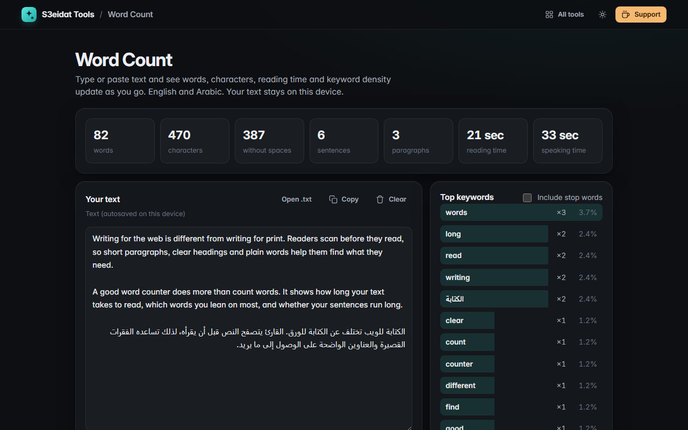

# Word Count

> Words, characters, reading time and keyword density. Free, private, and it runs entirely in your browser.

### ▶ [Open Word Count](https://s3eidat.github.io/word-count/)



## Features

- Live counts: **words**, **characters** (with and without spaces), **sentences**, **paragraphs**
- **Reading time** (238 words per minute) and **speaking time** (150 words per minute)
- Unique words, average word length, line count and longest word
- **Top keywords** with count and density; common English and Arabic stop words are skipped (toggle to include them)
- Works with **Arabic**: tashkeel and tatweel don't split words, `؟` ends a sentence, keywords ignore diacritics
- Emoji and accented letters count as one character each
- Open or drop a `.txt` file; your text is autosaved on this device only

## Privacy

Your text never leaves your device. There is no server, no account, no analytics.
The page ships with a strict Content-Security-Policy (`connect-src 'self'`), so the browser
itself blocks any attempt to send data anywhere. The autosave uses your browser's local storage;
**Clear** removes it.

## Run it yourself

It's plain HTML, CSS and JavaScript with no build step:

```bash
git clone https://github.com/s3eidat/word-count
cd word-count
python -m http.server 8000
```

Then open http://localhost:8000.

## Support

If this saved you time, **[buy me a coffee ☕](https://s3eidat.github.io/coffee/)**. It keeps every tool free.

---

Part of **[S3eidat Tools](https://s3eidat.github.io/)**: 100+ free, private tools that run in your browser. MIT licensed.
